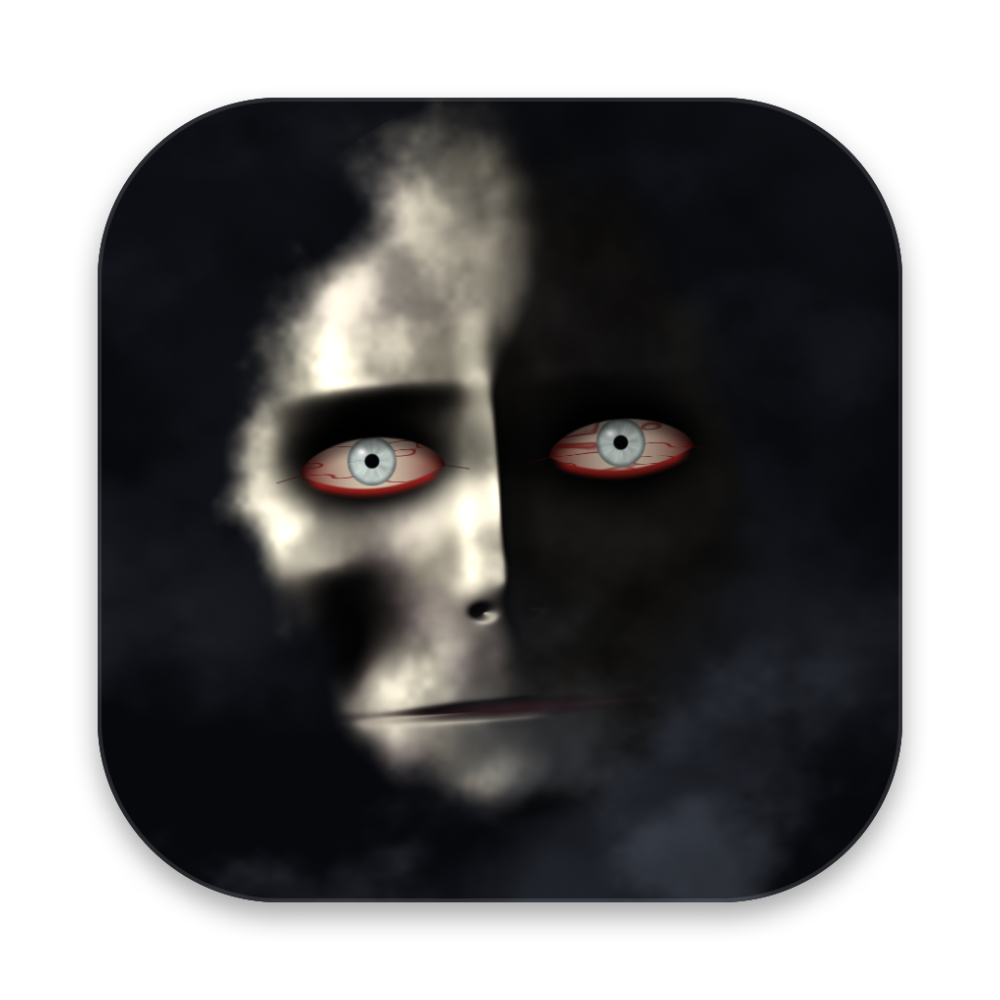
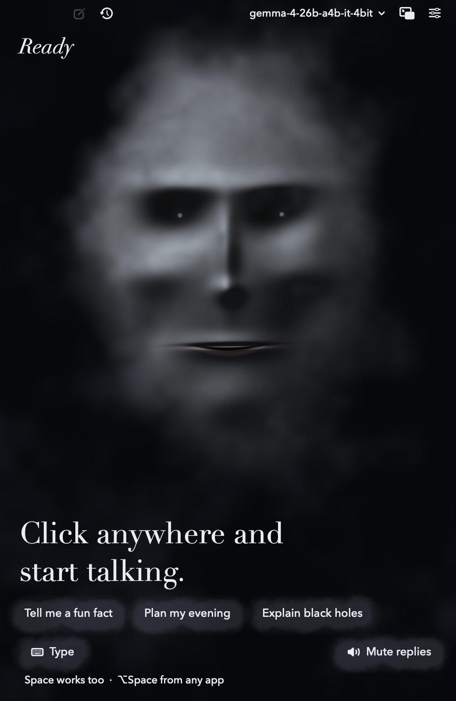
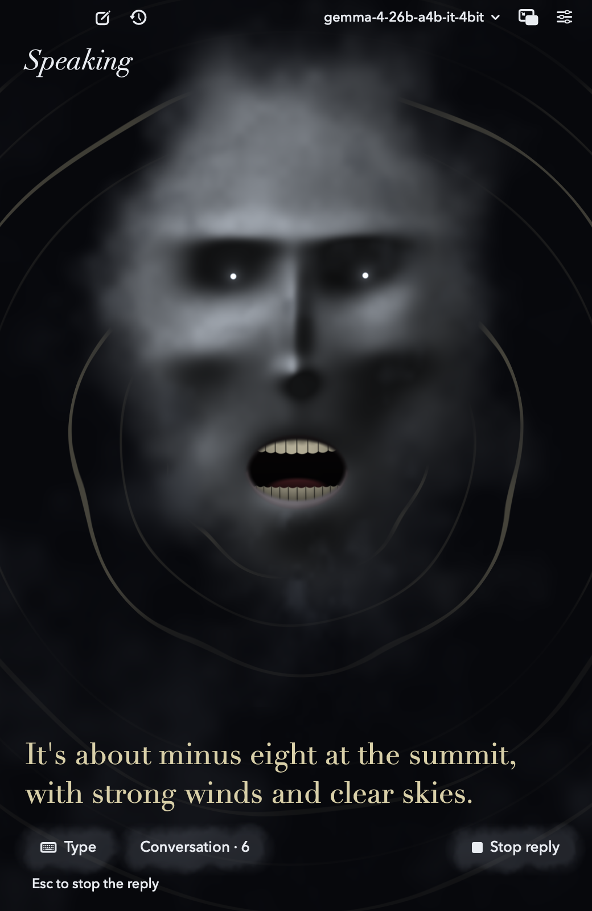
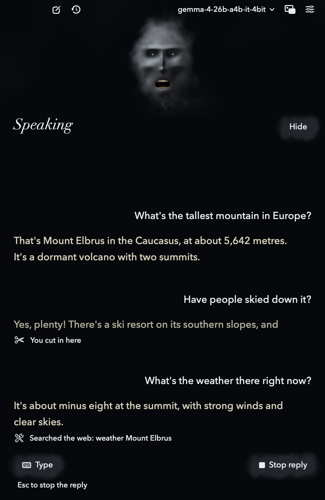
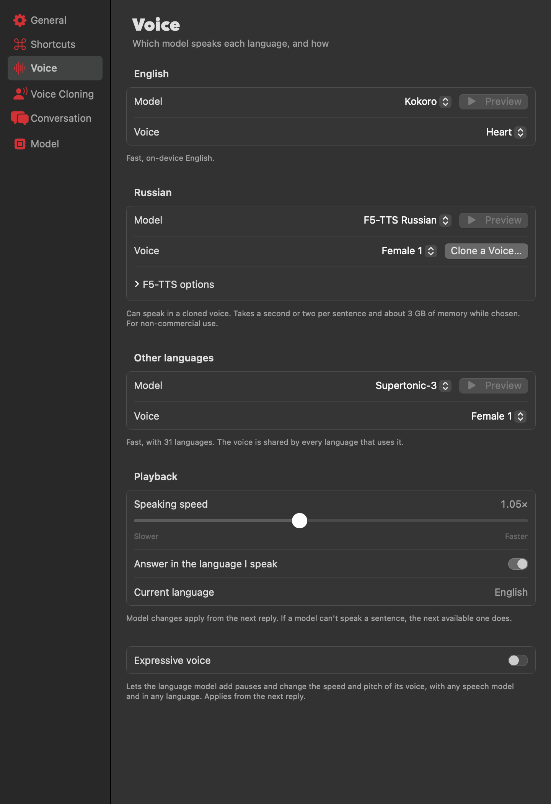
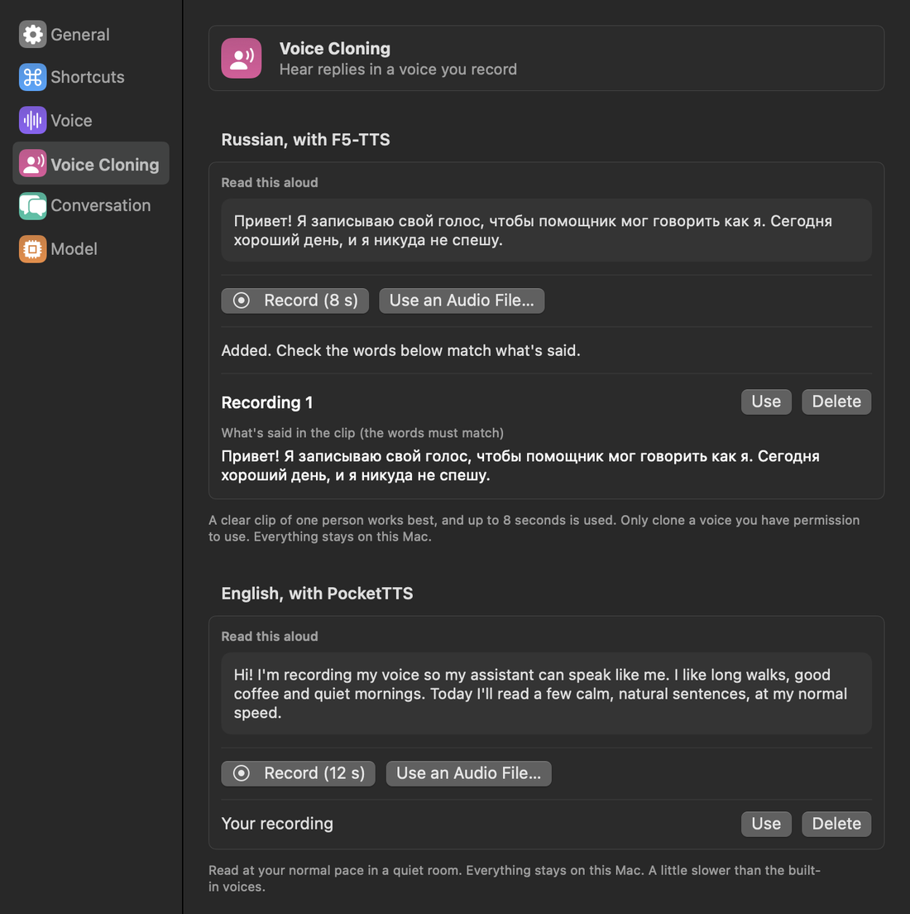

<p align="center">
  
</p>

<h1 align="center">Speak to Me</h1>

<p align="center">
  Talk to your local AI with your voice, on your own Mac.<br>
  You speak, it answers out loud, and you can interrupt it mid-sentence just by talking.
</p>

<p align="center">
  
  
  
  <a href="LICENSE"></a>
</p>

<table>
  <tr>
    <td></td>
    <td></td>
    <td></td>
  </tr>
</table>

Speak to Me is a native macOS app that turns any chat model served by [oMLX](https://github.com/jundot/omlx) into a voice assistant. Speech recognition, the language model and speech synthesis all run on your Mac.

> [!NOTE]
> This is an early personal project, so far run on one machine: an Apple M5 with 24 GB of memory on macOS 27. Reports from other Macs are very welcome.

## Features

- **Natural conversation.** Talk over a reply to interrupt it, without headphones. Replies start while the model is still writing.
- **Works from any app.** Press <kbd>⌥</kbd><kbd>Space</kbd> to talk, with a floating face and a menu bar icon.
- **A face that talks back.** A pale face hangs in black fog, its lips following the voice you hear and its eyes following your pointer. Voices ripple through the fog, and talking over it makes it lurch at you.
- **Answers in your language.** The language you speak is detected, and you choose the speech model for English, Russian and other languages.
- **Voice cloning.** Record a few seconds or pick an audio file, and hear replies in that voice in English or Russian.
- **Useful tools.** Web search, reading pages, the current time, and opening apps and web pages.
- **Sees your screen** when you ask, with a vision model and Screen Recording permission.
- **Talk or type.** Typed messages work too, and spoken replies can be muted.
- **Saved conversations,** kept on your Mac. The last one reopens on launch.

## Speech models

Choose a model for each language group in **Settings → Voice**. Switching takes effect from the next reply, and if a model can't say a sentence, the next available one does.

| Model | Languages | Good to know |
|---|---|---|
| [Kokoro 82M](https://huggingface.co/FluidInference/kokoro-82m-coreml) | English | The fast default, with 16 voices |
| [PocketTTS](https://huggingface.co/FluidInference/pocket-tts-coreml) | English | Speaks in a voice you've recorded; downloads about 550 MB |
| [Supertonic-3](https://huggingface.co/FluidInference/supertonic-3-coreml) | 31 languages | Fast, with several voices; downloads about 160 MB |
| [F5-TTS Russian](https://huggingface.co/Misha24-10/F5-TTS_RUSSIAN) | Russian | Can clone a voice. Slower, downloads about 1.4 GB, uses about 3 GB of memory, and needs macOS 26.2 or later. **Non-commercial use only** |
| macOS voices | Depends on what's installed | No download; add better ones in System Settings → Accessibility → Spoken Content |

<table>
  <tr>
    <td></td>
    <td></td>
  </tr>
</table>

## Getting started

You'll need:

- A Mac with Apple Silicon, on macOS 15 or later
- Xcode, plus its Metal Toolchain (`xcodebuild -downloadComponent MetalToolchain`)
- [oMLX](https://github.com/jundot/omlx) running, with at least one chat model. The app reads the host, port and API key from `~/.omlx/settings.json`

Then build and open the app:

```bash
git clone https://github.com/arccik/speak-to-me.git
```

```bash
cd speak-to-me
```

```bash
scripts/build-app.sh --install
```

```bash
open /Applications/SpeakToMe.app
```

The first build takes about 15 minutes, mostly compiling MLX's Metal shaders, and later builds reuse them. On first launch the app downloads its core speech models (about 1 GB). Other speech models download only when you choose them.

To keep the microphone permission across rebuilds, sign in to Xcode with an Apple Development certificate, which the script uses automatically. Otherwise macOS may ask again after each build.

## Using it

| Action | How |
|---|---|
| Start or stop talking | Click anywhere in the window, or <kbd>Space</kbd> |
| Talk from any app | <kbd>⌥</kbd><kbd>Space</kbd> (change it in Settings → Shortcuts) |
| Interrupt a reply | Just start talking |
| Stop a reply | <kbd>Esc</kbd> |
| Mute the mic | <kbd>M</kbd> |
| Show or hide the conversation | <kbd>C</kbd> |
| New conversation | <kbd>⌘</kbd><kbd>N</kbd> |
| Settings | <kbd>⌘</kbd><kbd>,</kbd> |

**For faster replies,** pick a mixture-of-experts model such as `gemma-4-26b-a4b` at the top of the window, because dense models of 12B and up feel slow in conversation. The ⚡ number shows the time from when you stopped talking to the first word of the reply. On the M5 above, that's about 1.2 s with Kokoro and that Gemma model, including the 0.77 s wait to be sure you've finished.

## Privacy

Your voice, conversations and cloned voices stay on your Mac. The app connects to the network only for:

- your oMLX server, which is local by default
- downloading speech models from Hugging Face
- web search and page reading, when the model uses those tools (turn them off in Settings → Conversation)

Only clone a voice you have permission to use.

## How it works

```
mic ─▶ echo cancel ─▶ Silero VAD ─▶ Parakeet v3 ─▶ oMLX ─▶ sentence splitter ─▶ speech model ─▶ speaker
```

Models run mostly on the Neural Engine through Core ML, which leaves the GPU to the language model. See [docs/ARCHITECTURE.md](docs/ARCHITECTURE.md) for the design, the latency tricks, the test modes and a map of the code.

## Contributing

Issues and pull requests are welcome, and reports from other Macs are especially useful. Before opening a pull request:

1. Build with `scripts/build-app.sh`.
2. Run the self tests that apply, listed in [docs/ARCHITECTURE.md](docs/ARCHITECTURE.md#tests-and-diagnostics).
3. For a visual change, render the window with `--snapshot` and include the images.

## License

The code is [MIT licensed](LICENSE). The speech models aren't in this repository: they download when needed and have their own licences, including F5-TTS Russian's non-commercial one. See [THIRD_PARTY_NOTICES.md](THIRD_PARTY_NOTICES.md).

## Acknowledgments

Built on [FluidAudio](https://github.com/FluidInference/FluidAudio), [MLX Swift](https://github.com/ml-explore/mlx-swift) and [oMLX](https://github.com/jundot/omlx). The F5-TTS code is ported from Lucas Newman's [f5-tts-mlx](https://github.com/lucasnewman/f5-tts-mlx) and [vocos-mlx](https://github.com/lucasnewman/vocos-mlx). Word stress comes from [RUAccent](https://github.com/Den4ikAI/ruaccent)'s dictionary.
